# AlphaRadar 技术方案

> **文档性质**：设计确认稿（不包含实现代码）  
> **依据**：`docs/architecture.md`（2026-11-04 基线）  
> **读者**：产品决策方、后续实现  
> **状态**：待确认。确认前不编写业务代码。

参考稿中的独立 ML 服务、LightGBM 训练和「评分映射为概率」不进入本方案。预测是外部大模型的主观情景，收益由程序事后回填。

---

## 0. 文档范围与设计决策

### 0.1 产品定位

个人使用的 A 股研究系统。每个交易日扫描全市场，用程序完成指标、评分和候选池，再用外部大模型研究未来 5—20 个交易日可能进入主升浪的股票。用户可随时对单只股票做 Stock Doctor 诊断。一期单用户。事实表不放用户字段；自选、持仓和以后的订阅使用 `owner_id`。

四个业务产品：

| 产品 | 触发 | 程序产出 | 模型产出 |
|---|---|---|---|
| 牛股发现 | 交易日 15:30 评分，20:30 研究 | 因子、牛股评分、候选池 | 研究报告、辩论、主观情景 |
| 个股诊断 | 用户提交代码和模式 | 九维诊断分、规则价位、盈亏 | 扣分解释和证据摘录 |
| 预测验证 | 持有期交易日走完 | 收益、波动、相对沪深300超额 | 不改提示词，不改模型权重 |
| 监控预警 | 交易日盘中与收盘 | 异动是否成立 | 提醒只引用已有告警 |

### 0.2 必须遵守的决策

| # | 约束 | 落地方式 |
|---|---|---|
| C1 | 评分可配置、可解释，不是上涨概率 | `bull_v1` 与 `diagnosis_v1` 分表。接口不返回概率字段 |
| C2 | 牛股评分、诊断评分、主观情景三者分开 | 独立表、独立资源 |
| C3 | Java 编排和查询；Quant 计算；Agent 调用模型 | 浏览器只访问 Nginx。Python 服务不互相调用 |
| C4 | 预留订阅 | `owner_id` 从 P3 启用。P0 不做租户和计费 |
| C5 | 模块可独立测试 | 规则和指标做成纯函数。Compose 可按服务启停 |
| C6 | 禁止未来数据 | 特征只使用 `data_cutoff` 及之前的数据。财务以公告日为准 |
| C7 | 采集幂等、重试、断点 | `data_ingest_checkpoint` + 业务唯一键 |
| C8 | 停牌、ST、涨跌停、退市 | 当日状态来自历史区间。候选池、诊断和回测共用同一套过滤配置 |
| C9 | 模型不编造行情和价位 | 价位只来自规则编号。数据包中不存在的价格整条丢弃 |
| C10 | 不训练、不微调 | 不设 ML 服务，不保存 LightGBM 制品 |

### 0.3 技术栈

- Java 21、Spring Boot 3、Spring Security、MyBatis-Plus、Flyway、Maven、springdoc
- Python 3.12、FastAPI、Pandas、NumPy、pandas-ta
- Agent 使用模块化工作流。LangGraph 只作为以后替换编排器的选项，P3 不绑定
- PostgreSQL 16、Redis 7
- Vue 3、TypeScript、Element Plus、ECharts、Pinia、Axios
- Docker Compose、Nginx
- XXL-JOB 到 P5 再接入。P0 只建调度配置表

---

## 1. 技术架构

### 1.1 逻辑分层

```text
┌──────────────────────────────────────────────────────────────┐
│ Presentation：Vue 3                                                   │
│  P0 健康首页；P6 日报、诊断、板块、模型管理和预警                     │
├──────────────────────────────────────────────────────────────┤
│ BFF：alpharadar-api（Spring Boot）                                   │
│  鉴权、OpenAPI、任务触发、查询编排                                     │
├────────────────────────────┬─────────────────────────────────┤
│ Orchestration              │ Domain（Java，只读事实、写配置）   │
│  交易日判断、幂等键、任务状态 │  报告组装、告警投递、用户           │
├────────────────────────────┴─────────────────────────────────┤
│ Compute：alpharadar-quant（FastAPI）                                  │
│  采集适配、指标、两套评分、规则价位、回测、收益回填                     │
├──────────────────────────────────────────────────────────────┤
│ Research：alpharadar-agent（FastAPI）                                 │
│  统一模型客户端、研究、辩论、诊断解释                                   │
├──────────────────────────────────────────────────────────────┤
│ Data：PostgreSQL 权威存储；Redis 只做锁和短期缓存                      │
└──────────────────────────────────────────────────────────────┘
```

1. 页面只依赖 Java，不直连 Python 或数据库。
2. 任务状态以 Java 写入的记录为准。
3. Quant 按请求计算，不自行决定日批时间。
4. 采集只通过适配器。写入前统一单位、来源和采集时间。
5. Redis 不是行情和评分的权威库。

### 1.2 服务边界

| 服务 | 技术 | 职责 | 不做什么 |
|---|---|---|---|
| alpharadar-api | Spring Boot | REST、鉴权、编排、报告和告警查询 | 不算指标，不调用大模型 |
| alpharadar-quant | FastAPI | 采集、因子、评分、价位、回测、回填 | 不调用大模型，不向前端暴露 |
| alpharadar-agent | FastAPI | 模型调用、研究、辩论、解释 | 不重新计算指标和价位 |
| alpharadar-web | Vue 3 | 展示和输入 | 不含评分规则 |
| postgres / redis | — | 权威库 / 锁 | Redis 不保存事实 |

不部署独立的 ML 服务，也不把 Quant 和 Agent 合成一个进程。

### 1.3 全局业务架构

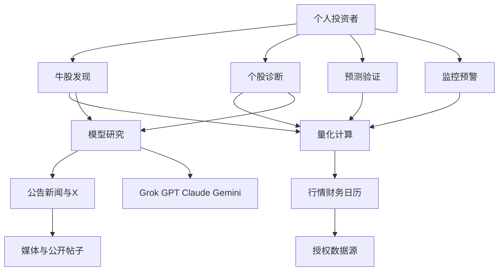

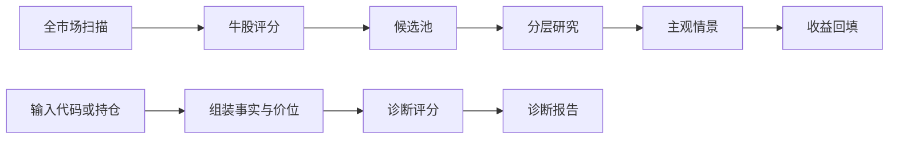

### 1.4 部署拓扑

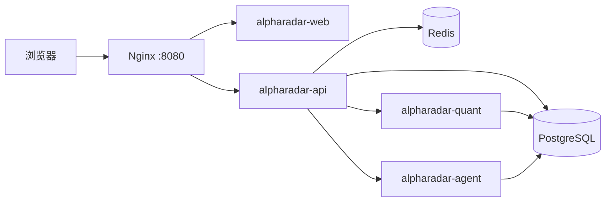

Nginx 只公开页面、`/api`、`/quant/health` 和 `/agent/health`。`/internal`、PostgreSQL 和 Redis 不对浏览器开放。

### 1.5 同步与异步

| 路径 | 模式 | 说明 |
|---|---|---|
| 查询股票、评分、诊断、报告 | 同步 | API 读库 |
| 单股诊断 | 同步，长超时 | API 先调 Quant，再调 Agent |
| 全市场采集、因子、评分 | 异步任务 | API 创建任务，Quant 分段执行 |
| 晚间研究 | 异步任务 | 只处理当日候选池 |
| 收益回填、回测 | 异步任务 | Quant 执行，API 记录状态 |
| 盘中预警 | 异步任务 | 没有实时行情适配器时跳过 |

P0 到 P4 用数据表记录任务状态，并用 Redis 锁防止同一交易日重叠。P5 再把 cron 接到 XXL-JOB。不引入 Kafka。

### 1.6 日批主链路

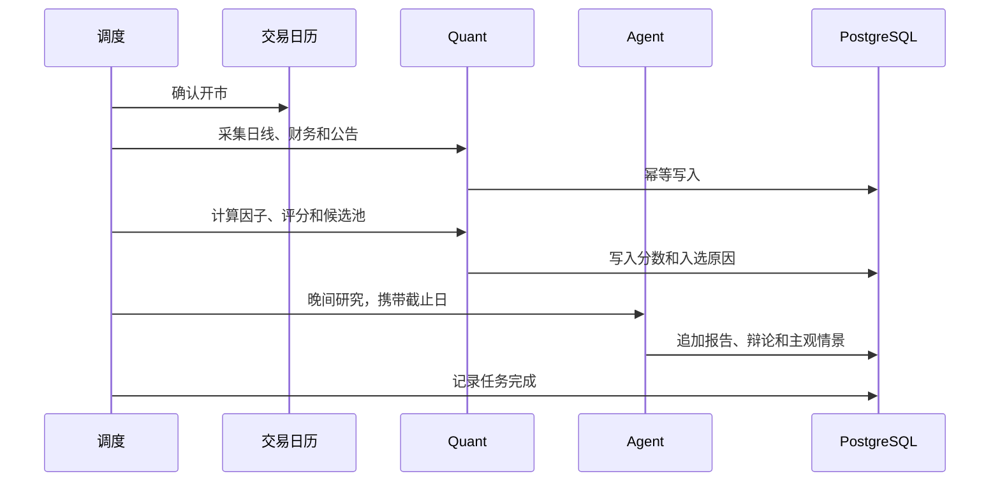

15:30 只做到评分和候选池。20:30 才调用模型。

---

## 2. 模块依赖

### 2.1 业务模块

| ID | 模块 | 阶段 | 主进程 |
|---|---|---|---|
| M01 | 用户与系统管理 | P0 登录，P3 用户表，P5 调度执行 | API |
| M02 | 股票基础信息 | P1 | Quant 写，API 查 |
| M03 | 交易日历 | P0 建表，P1 入库 | Quant |
| M04 | 行情采集 | P1 | Quant |
| M05 | 财务采集 | P1 | Quant |
| M06 | 技术指标 | P2 | Quant |
| M07 | 板块与市场环境 | P2 | Quant |
| M08 | 牛股评分与候选池 | P2 | Quant |
| M09 | 公告采集 | P3 | Quant |
| M10 | 新闻与社交媒体 | P3 | Quant 落库，Agent 判级 |
| M11 | 多模型管理 | P0 建表，P3 调用 | Agent |
| M12 | Agent 编排 | P3 | Agent |
| M13 | 个股研究 | P3 | Agent |
| M14 | 多空辩论 | P3 | Agent |
| M15 | 牛股预测 | P3 写情景，P4 回填 | Agent / Quant |
| M16 | Stock Doctor | P3 | API 编排，Quant 计分，Agent 解释 |
| M17 | 每日报告 | P3 组装，P6 页面 | API |
| M18 | 预测追踪 | P4 | Quant |
| M19 | 历史回测 | P4 | Quant |
| M20 | 监控预警与消息推送 | P5 | Quant 判断，API 推送 |
| M21 | 模型成本统计 | P3 | Agent 写日志，API 汇总 |

### 2.2 Agent

每日研究：

| Agent | 输入 | 输出 | 依赖 |
|---|---|---|---|
| Grok 情报 | 候选股和公开资料 | 带链接的产业与帖子摘录 | M10、M11 |
| GPT 研究 | 截止日事实包 | 事实、推断、不确定性 | M08、M05、M09 |
| Claude 审查 | 同一事实包，不含看多结论 | 风险和反方证据 | M13 |
| GPT 汇总 | 已落库的研究和审查 | 观察结论和主观情景 | M14、M15 |

Stock Doctor 的解释步骤按 `diagnosis_agent_plan` 选择：technical、volume、capital、fundamental、valuation、news、industry、holder、sentiment、risk、decision。Risk 不读取其他步骤的看多结论。Decision 只汇总已有证据。

Agent 之间只交换版本化 JSON。输出里的 `prices` 必须为空。

### 2.3 依赖关系

```text
M03 交易日历 → M04 行情 → M06 指标 → M08 评分 → 候选池
M05 财务、M07 板块 → M08
M09 公告、M10 新闻 → 研究与诊断
候选池 → M12 编排 → M13 研究 → M14 辩论 → M15 情景
M15 → M18 回填
M06、M08 → M16 诊断
M08、M15、M16 → M17 日报
M06 → M19 回测
M08、M09 → M20 预警
```

评分结果可以出现在研究输入里，但不能写成上涨概率，也不能作为主观情景的数值概率。

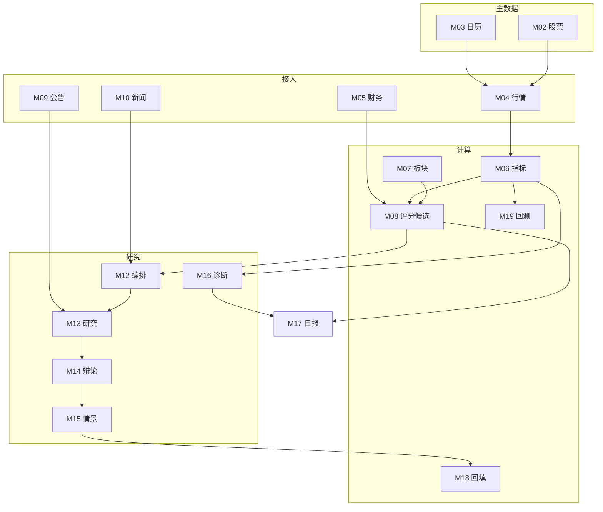

### 2.4 调用契约

| 调用方 | 被调用方 | 契约 | 同步性 |
|---|---|---|---|
| API | Quant `/internal/market/sync` | 数据集、交易日区间 | 异步 |
| API | Quant `/internal/factors/rebuild`、`/scores/rebuild` | 截止日、规则版本 | 异步 |
| API | Quant `/internal/diagnoses/{id}/facts` | 诊断编号 | 同步 |
| API | Agent `/internal/diagnoses/{id}/explain` | 诊断编号、方案版本 | 同步 |
| API | Agent 晚间研究 | 候选列表、截止日、路线版本 | 异步 |
| API | Quant `/internal/predictions/evaluate` | 已到期情景 | 异步 |
| Agent | 不调用 Quant | 只读 Quant 已落库的数据 | — |

服务间请求头为 `X-Internal-Token`。Nginx 不转发该路径。

---

## 3. 数据库设计

每张表都有 `id`、`created_at`、`updated_at`、`source`。迁移脚本写中文注释。时间戳用 UTC，交易日用 `date`。价格单位是元，成交量是股，成交额是元。

确认后的建表 SQL 按阶段迁移：`V1` P0，`V2` P1，`V3` P2，`V4` P3，`V5` P4。本文件先固定字段和唯一键。

### 3.1 关系

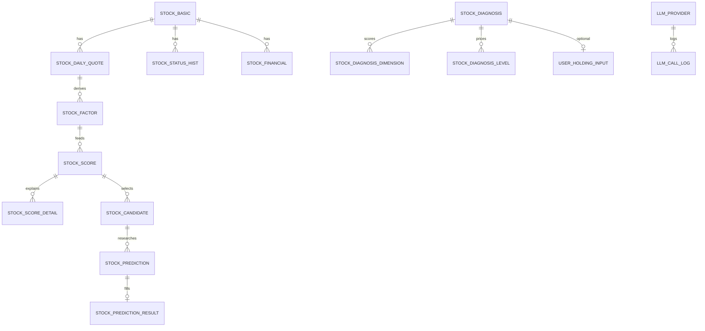

### 3.2 P0

| 表 | 唯一键 | 关键字段 |
|---|---|---|
| trading_calendar | exchange + cal_date | is_open |
| llm_provider | provider_code | base_url、model_name、api_key_env、timeout_ms、enabled、capabilities |
| llm_prompt | prompt_code + version | task_type、content |
| llm_task_route | task_code + version + provider_code + sort_order | model_name、max_symbols、enabled |
| system_schedule | task_code | cron、timezone、requires_trading_day、enabled |

P0 插入四家供应商和六条调度，全部 `enabled=false`。不插入密钥和提示词正文。登录账号来自环境变量，P0 不建用户表。

### 3.3 P1

| 表 | 唯一键 | 关键字段 |
|---|---|---|
| stock_basic | ts_code | symbol、name、exchange、list_date、delist_date、list_status |
| stock_status_hist | ts_code + effective_from | name、is_st、list_status、trade_status、effective_to |
| stock_daily_quote | ts_code + trade_date + source | 未复权 OHLC、volume、amount、换手率、涨跌停价、trade_status、limit_status、is_st、credibility、ingest_rule_version |
| stock_adj_factor | ts_code + trade_date + source | adj_factor |
| index_daily | index_code + trade_date + source | 五个指数的 OHLC 和成交额 |
| stock_financial | ts_code + report_period + report_type + period_scope + source | announce_date 必填，单季与累计分开 |
| stock_minute_quote | ts_code + bar_time + freq + source | P1 只建表 |
| data_ingest_checkpoint | source + dataset | cursor、status、row_count |

`trade_status` 取 trading、suspended。`limit_status` 取 none、up、down、one_word。查询索引是 `ts_code, trade_date desc`。

截止日 T 的复权收盘价：

```text
adj_close(t) = close(t) * adj_factor(t) / adj_factor_asof(T)
```

`adj_factor_asof` 只取 T 及之前最近的一条。

### 3.4 P2

| 表 | 唯一键 | 关键字段 |
|---|---|---|
| stock_factor | ts_code + trade_date + factor_code + factor_version | value、value_status、data_cutoff |
| stock_score | ts_code + trade_date + rule_version | total_score、band、completeness、data_cutoff |
| stock_score_detail | score_id + dimension_code | score、max_score、status、evidence |
| stock_candidate | trade_date + rule_version + ts_code | rank_no、band、reason、data_cutoff |
| sector_basic | source + sector_code | sector_type、name、level |
| sector_stock_relation | sector_id + ts_code + relation_type + effective_from | effective_to |
| sector_daily_quote | sector_id + trade_date + source | 5/20/60 日涨幅、成交额、上涨比例、涨停数、龙头 |
| market_environment | trade_date + rule_version | regime、成交额、涨跌家数、涨跌停家数、连板高度 |

`value_status` 取 ok、insufficient_data、suspended。`band` 取 focus、potential、watch、ignore、incomplete。`relation_type` 取 core、direct、indirect、concept。`regime` 取 bull、range、weak。

### 3.5 P3

`app_user`：username 唯一，password_hash 保存 BCrypt。

公告、新闻、新闻关联、Agent 任务和执行、研究报告、辩论、调用日志、诊断方案、诊断主表、诊断维度、诊断价位、诊断证据、持仓输入。诊断主表只追加。持仓输入以 diagnosis_id 唯一。Java 写成本、数量、仓位、周期和风险偏好；Quant 写市值、盈亏、盈亏比例和 quote_id。

证据等级为 A、B、C、D。诊断趋势阶段只接受程序给出的八个枚举。

### 3.6 P4

`stock_prediction` 只追加。`horizon` 只允许 5、10、20。`prediction_kind` 检查约束固定为 `subjective_scenario`。修正时新增行并填写 `supersedes_id`。

`stock_prediction_result` 以 prediction_id 为主键。未走完的持有期，对应收益列为空。

`stock_watchlist` 唯一键为 owner_id + ts_code。`stock_alert` 只追加。`stock_holder` 等股东数据源确定后再定唯一键，字段必须同时有报告期和披露日。

---

## 4. 数据源接入

### 4.1 适配器

```text
MarketDataAdapter
  fetch_calendar
  fetch_securities
  fetch_daily
  fetch_adj_factor
  fetch_limits
  fetch_suspend
  fetch_index_daily
  fetch_financials
  fetch_announcements
```

业务代码只依赖这个接口。日线、财务、公告和新闻分别配置，可以单独替换。实时行情是另一个适配器，P1 不启用。无偿爬虫不作为生产行情源。

默认日线和财务实现是 Tushare Pro，令牌读取 `TUSHARE_TOKEN`。转换规则版本 `tushare_daily_v1`：成交量手乘 100 为股，成交额千元乘 1000 为元，OHLC 不在采集时复权。

### 4.2 幂等与断点

幂等键是 `source + dataset + ts_code + trade_date`，落在各表唯一键上，使用 upsert。checkpoint 记录最后完整成功的交易日。网络错误、超时和 429 重试 3 次，间隔 1 秒、2 秒、4 秒。401 和 403 不重试。失败不写入估算行情。

公告日为空的财务报表丢弃。读取财务的条件是 `announce_date <= 截止日`。

### 4.3 交易状态

| 场景 | 评分 | 候选池 | 回测成交 | 诊断 |
|---|---|---|---|---|
| 停牌 | 因子可计算，状态 suspended | 剔除 | 当日不可买卖 | 不给启动信号 |
| ST | 使用当日历史状态 | 剔除 | 默认可配置过滤 | 报告标明 ST |
| 涨跌停 | 写入 limit_status | 保留并在原因中标记 | 一字涨停不可买，一字跌停不可卖 | 价位仍按规则计算 |
| 退市 | 保留历史 | 当前状态不是上市则剔除 | 不新开仓 | 不能作为诊断对象 |

同一份过滤配置同时给评分、候选池和回测使用。

---

## 5. 仓库目录

采用单仓。P0 的 Java 是一个可运行模块，包按后续模块预留，不在 P0 拆成多个服务。

```text
alphaRadar/
  docker-compose.yml
  .env.example
  .gitignore
  nginx/conf.d/default.conf
  openapi/
  db/migration/
  configs/score/bull_v1.yaml
  configs/score/diagnosis_v1.yaml
  configs/factor_v1.yaml
  configs/backtest_v1.yaml
  apps/api/
  apps/quant/
  apps/agent/
  apps/web/
  docs/architecture.md
  docs/technical-design.md
```

`.env.example` 只列出变量名，口令和密钥留空：`POSTGRES_PASSWORD`、`APP_USERNAME`、`APP_PASSWORD`、`INTERNAL_TOKEN`、`TUSHARE_TOKEN`、四家模型密钥、`ALERT_WEBHOOK_URL`。`.gitignore` 忽略 `.env`。

---

## 6. 分阶段任务

### 6.1 范围

| 阶段 | 完成时能够做到 | 明确不做 |
|---|---|---|
| P0 | 四个服务和数据库启动，五张基础表可重复迁移 | 采集、指标、模型调用、业务页面 |
| P1 | 查询全 A 股主数据、历史日线和带公告日的财务 | 用爬虫充当实时行情 |
| P2 | 每个交易日生成可追溯候选池和规则价位函数 | 把评分写成概率 |
| P3 | 单只股票生成研究报告、辩论和诊断结论 | 无差别调用模型分析全市场 |
| P4 | 查看历史情景和之后的真实收益，回测遵守成交约束 | 根据结果自动改权重 |
| P5 | 按北京时间交易日历自动执行并提醒 | 自动下单 |
| P6 | 首页、研究、诊断、板块、模型管理和预警可访问 | 在 P0 提前做这些页面 |

### 6.2 P0 任务

| 任务 | 依赖 | 交付物 | 完成定义 |
|---|---|---|---|
| T1 Compose 与目录 | — | compose、env 样例、gitignore | Postgres 与 Redis 健康 |
| T2 Flyway V1 | T1 | 五张基础表和注释 | 迁移可重复执行 |
| T3 Java 健康检查与登录 | T2 | SecurityConfig、Basic 认证 | `/api/health` 匿名可访问，其余 401 |
| T4 Quant 与 Agent | T1 | 两个 `/health` 和 OpenAPI | 启动不要求模型密钥 |
| T5 Vue 与 Nginx | T3、T4 | 健康状态首页 | 浏览器打开 8080 能看到三个状态 |

```text
docker compose up -d postgres redis
cd apps/api && mvn test
cd apps/quant && uv run pytest
cd apps/agent && uv run pytest
cd apps/web && npm run build
docker compose up --build -d
curl -fsS http://localhost:8080/api/health
curl -fsS http://localhost:8080/quant/health
curl -fsS http://localhost:8080/agent/health
```

P0 完成后停止。P1 才实现适配器和行情表。

---

## 7. 评分、诊断与主观情景

### 7.1 牛股评分 bull_v1

维度满分必须合计 100，否则任务失败。单条规则缺少输入时不加分。一个维度中，缺失规则的满分合计超过该维度 40% 时，维度分数为空。空维度不把其余分数摊成 100。第三方主力净流入不参与评分。

| 维度 | 规则与得分 |
|---|---|
| 趋势 25 | 四条均线多头 8，仅短均线多头 4；MA20 斜率为正 4；收盘价高于 MA20 得 3；MACD 多头 4；RSI14 在 50–80 得 3，高于 80 得 1；20 日涨幅为正 3 |
| 量价 20 | 成交额达到初始门槛 2 亿元得 4；量比 1.2–3 得 4，3–5 得 2；换手率 3%–15% 得 3；放量突破前 20 日高点 5；缩量回踩 4 |
| 产业 15 | 板块 20 日涨幅前 20% 得 6；上涨比例不低于 60% 得 4；个股强于板块 5 |
| 基本面 15 | 累计营收同比为正 4；累计扣非同比为正 4；经营现金流为正 3；毛利率不低于上一期 2；累计 ROE 不低于 8% 得 2 |
| 资金股东 10 | 已披露股东人数下降 4；重要股东净增持 3；机构持股比例上升 3。数据未接入则维度为空 |
| 催化 10 | 20 个交易日内 A/B/C 级正面事件得 6/3/1。适配器已确认没有事件时得 0；适配器未运行则为空 |
| 弹性 5 | ATR 占收盘价 2%–6% 得 2；距 120 日高点回撤 10%–40% 得 3 |

分档：85 及以上重点关注，75 及以上潜在启动，60 及以上观察，低于 60 暂不关注。有空维度时分档为 incomplete，不进入前三档。

候选池还要满足：当日可交易、非 ST、上市满 60 个交易日、趋势和量价都已算出。按总分取路线中的数量，默认 100。

### 7.2 诊断评分 diagnosis_v1

九维满分依次为技术 20、量价 15、资金 10、基本面 15、估值 10、消息 10、产业 10、情绪 5、风险 5。风险分越高，表示已证实风险越少。只有第三方资金估算时，资金分上限为 3。亏损企业不用负 PE。D 级证据不能单独支撑消息满分。筹码没有独立分数；没有可靠来源时报告写明缺失。

趋势阶段按顺序匹配：下跌趋势、趋势转弱、加速上涨、高位震荡、主升浪、趋势启动、底部反转、底部震荡。均线不足则阶段为空。

价位规则：

| rule_code | 计算 |
|---|---|
| support_ma20 | MA20 |
| support_swing_low_20 | 截止日之前 20 根 K 线最低价 |
| resistance_prior_high_20 | 截止日之前 20 根 K 线最高价 |
| resistance_120d_high | 截止日之前 120 根 K 线最高价 |
| stop_ref_atr | 已选支撑减 1 倍 ATR14 |
| take_profit_nearest | 高于收盘价的最近压力 |
| take_profit_atr2 | 没有压力位时，收盘价加 2 倍 ATR14 |

已选支撑是低于收盘价的支撑中较高的一个。历史不足则不写该价位。补仓必须同时满足阶段、支撑和量价条件。浮亏本身不是补仓条件。

### 7.3 主观情景

5、10、20 日各追加一条记录，共用同一行情编号。情景只引用已有 `rule_code`。`prediction_kind` 固定为 `subjective_scenario`。相同截止日、持有期、模型和提示词版本已存在时返回原编号。

收益回填使用复权收盘价。持有期未结束的列保持空白。回填不修改提示词、路线和评分规则。

---

## 8. 重点模块业务交互

### 8.1 行情采集

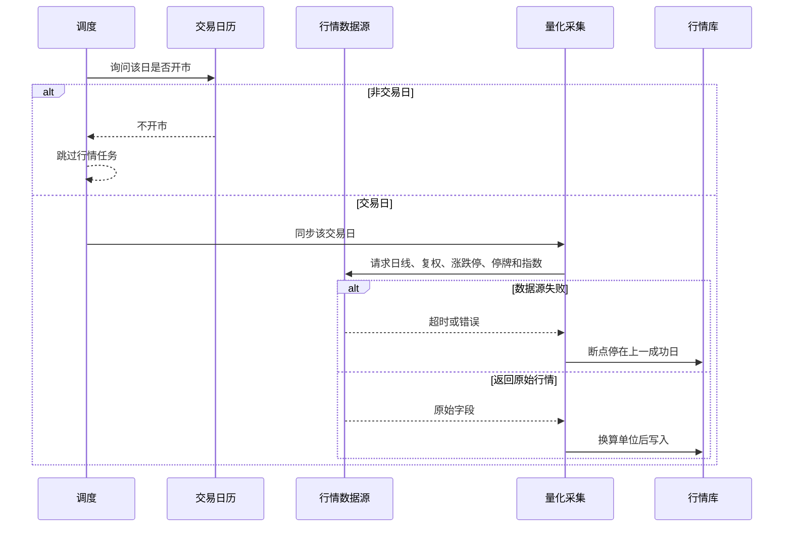

### 8.2 财务采集

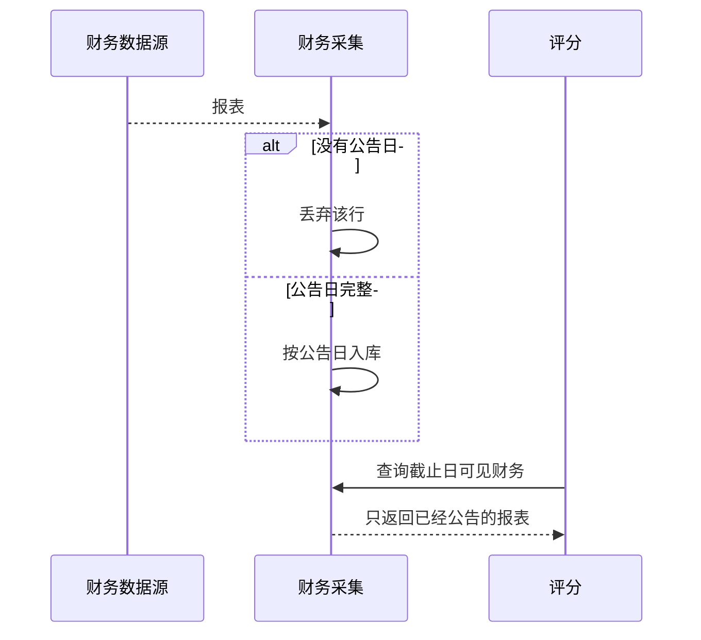

### 8.3 牛股评分与候选池

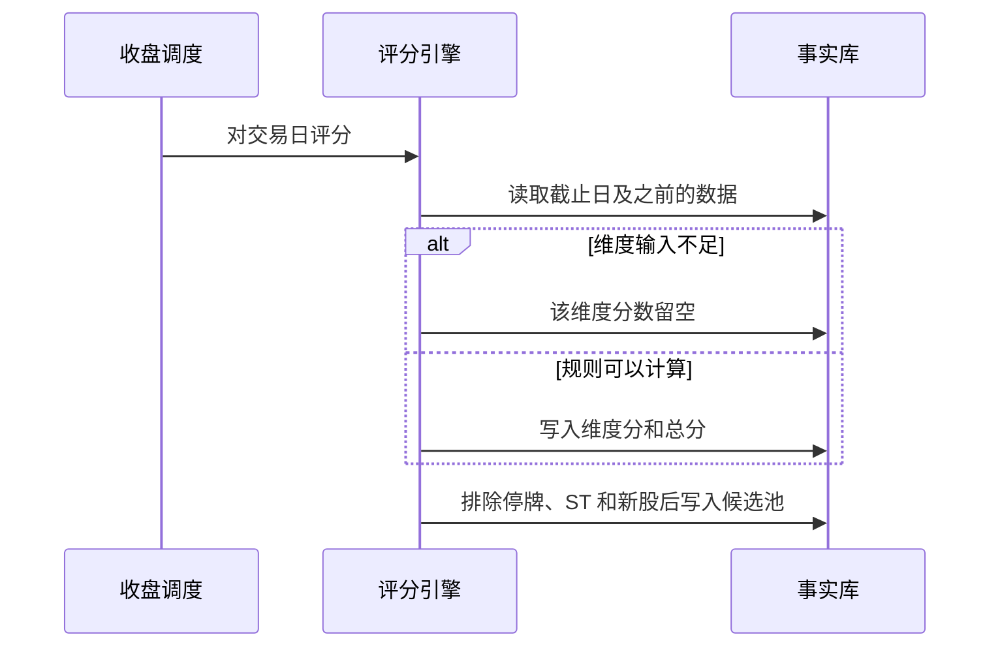

### 8.4 Agent 编排

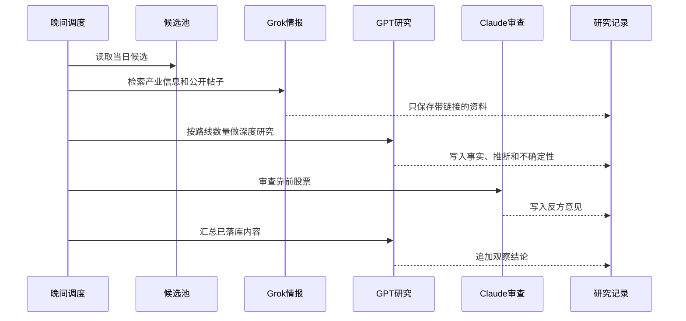

数量默认是候选约 100、深研约 20、审查约 10，全部来自 `llm_task_route`。候选不足时不放宽 ST 和停牌条件。

### 8.5 多空辩论

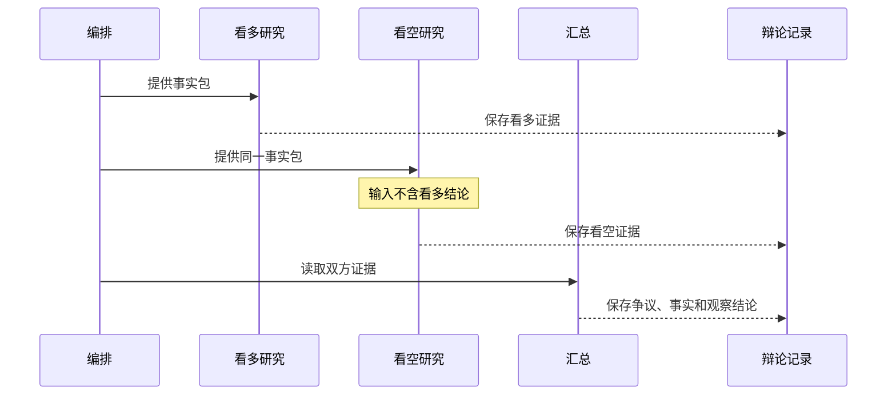

### 8.6 牛股预测

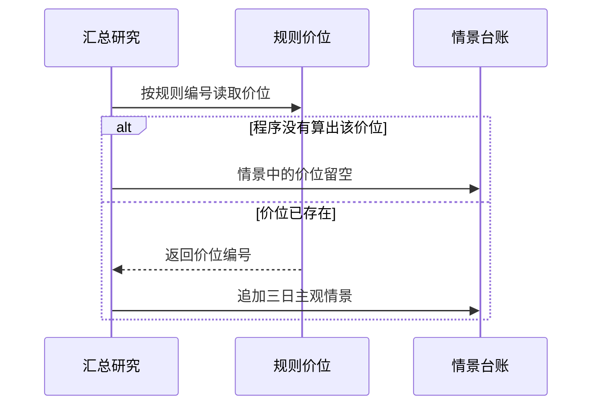

### 8.7 Stock Doctor

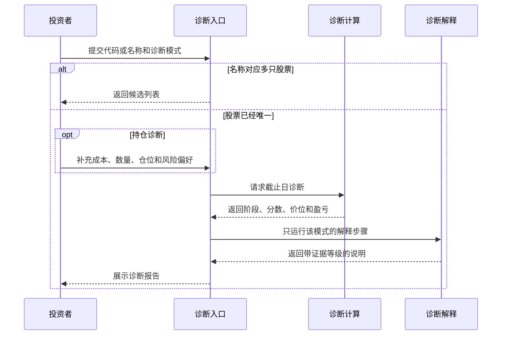

四种模式的解释步骤：全面诊断运行全部步骤；短线运行技术、量价、资金、消息、情绪、风险和汇总；中线运行基本面、估值、消息、产业链、股东、风险和汇总；持仓诊断在短线或中线之后追加持仓条件。

### 8.8 每日报告

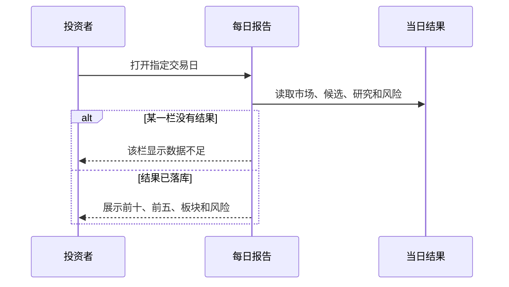

报告中的价格等于该交易日日线收盘价。重点研究只包含当晚实际跑完的股票。

### 8.9 预测追踪

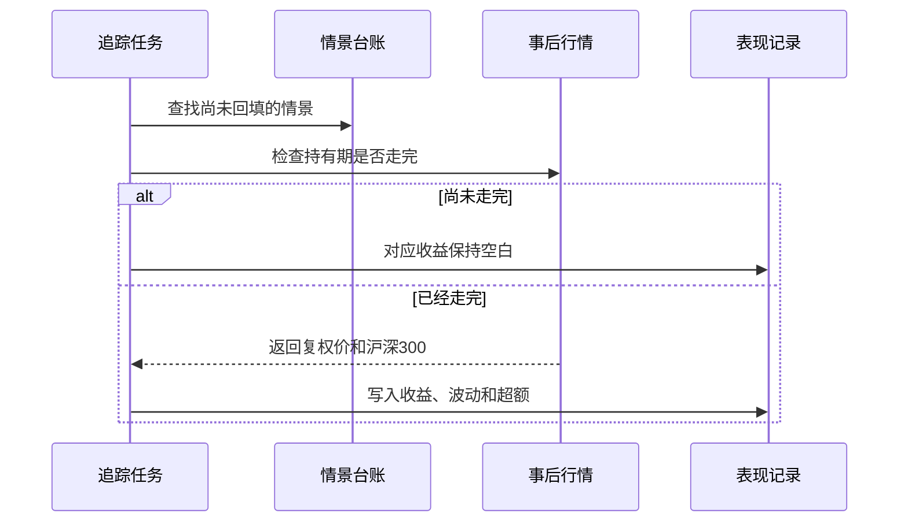

### 8.10 监控预警与消息推送

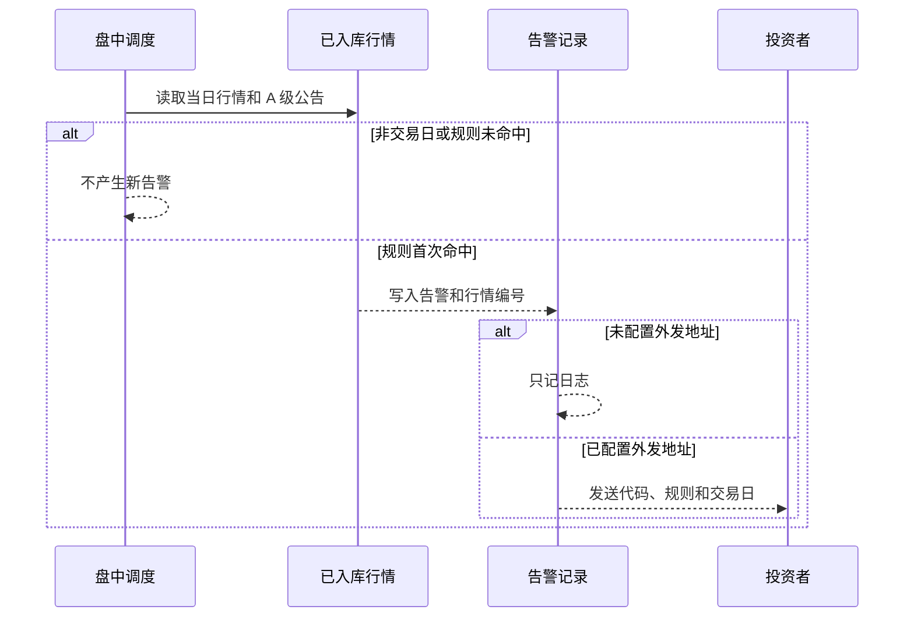

同一股票、同一规则、同一交易日只有一条告警。推送连续失败 3 次后状态改为通知失败，下一轮再试。

---

## 9. 接口草图

错误响应：

```json
{"code": "STRING_CODE", "message": "说明", "traceId": "请求号"}
```

评分响应只包含分数和依据：

```json
{
  "tsCode": "600000.SH",
  "tradeDate": "2026-11-03",
  "ruleVersion": "bull_v1",
  "totalScore": 78.5,
  "band": "potential",
  "completeness": "partial",
  "dimensions": [],
  "dataCutoff": "2026-11-03"
}
```

主观情景响应：

```json
{
  "tsCode": "600000.SH",
  "horizon": 10,
  "predictionKind": "subjective_scenario",
  "quoteId": 1001,
  "levels": [{"ruleCode": "support_ma20", "price": 10.25}],
  "dataCutoff": "2026-11-03",
  "modelName": "配置中的模型名",
  "promptVersion": 1
}
```

诊断响应另外包含 `mode`、`trendStage`、九维分数和证据等级。没有 `proba` 字段。

对外路径在第 2.4 节已经固定。P0 只实现三个健康检查。

---

## 10. 已锁定决策

以下事项按现行基线执行，不再回到参考稿中的自训练方案：

1. 主数据源是可替换的 Tushare Pro 适配器。实时行情单独适配，P1 不启用。
2. 仓库使用单仓。
3. P0 包含健康状态首页，不包含研报和诊断页面。
4. P3 使用模块化工作流，不在 P0 引入 LangGraph。
5. 预测记录是主观情景，收益由程序回填。
6. 牛股评分使用第 7.1 节的七维权重。诊断使用第 7.2 节的九维权重。
7. 股票池包含沪深北 A 股。候选池剔除当日 ST、停牌和上市不满 60 个交易日的股票。
8. P0 使用环境变量中的 HTTP Basic。P3 再落本地用户表。
9. 确认后只实现第 6.2 节的 P0。

若要改其中某一条，指出编号即可。确认前不编写业务实现代码。
